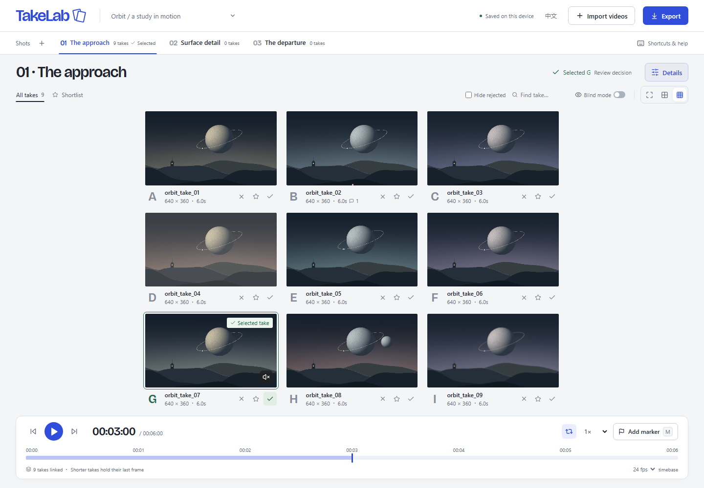

# TakeLab

**Compare AI video takes. Pick the best shot. Keep the recipe.**

AI 视频选片台：比较同一镜头的多个生成版本，选出可用素材，并保留生成记录。

[中文说明](README.zh-CN.md) · [User guide](docs/USER_GUIDE.md) · [Architecture](docs/ARCHITECTURE.md) · [Contributing](CONTRIBUTING.md)



TakeLab is a local-first video review desk for the moment _after_ generation. Bring files from different models or cameras, compare them together, and keep the prompt and notes behind your decision. No account, API key, paid generation, or media upload is required.

**Status: v0.1.0 implementation.** Local workflows are implemented and tested in Chromium. This is a review tool, not a frame-accurate editor or an archival storage service.

## Start in a minute

Requires **Node.js 22.12+** and npm. Desktop Chrome or Edge is the recommended starting point.

```sh
git clone https://github.com/Ray0766/takelab.git
cd takelab
npm ci
npm run dev
```

Open [localhost:4173](http://127.0.0.1:4173/), then choose **Or explore a 9-take demo**. The nine included clips are original procedural artwork, take six seconds to review, and need no downloads beyond this repository. The interface supports English and Simplified Chinese.

1. Drop a batch of videos into a shot.
2. Press **Space** to compare; **← / →** step through the review timebase.
3. **X** rejects a take, **S** shortlists it, **W** selects the shot's winner.
4. Press **M** to leave a note at the current source time.
5. Open **Decision**, write a reason and link supporting markers, including flaws in rejected candidates. Reveal the generation record and export the result.

## What works

| Workflow          | v0.1 behavior                                                                                                                |
| ----------------- | ---------------------------------------------------------------------------------------------------------------------------- |
| Import            | Multi-file picker or drag and drop; duplicate detection; optional shot grouping from `scene_take_01` / `scene_v02` filenames |
| Compare           | 1 / 4 / 9-player layouts, shared transport, timeline seeking, looping, speed controls, per-take start offsets                |
| Review            | One winner per shot, shortlist, rejection, hide rejected, filename/model search, keyboard shortcuts                          |
| Blind selection   | Shuffles take order; hides filenames, model, prompt, references, seed and cost until revealed                                |
| Annotations       | Timestamped issue, good-moment and note markers; jump back to a marker; delete it                                            |
| Decision evidence | Winner + rationale + explicit cross-candidate source-time evidence, linked to generation records with stable IDs in exports  |
| Generation record | Prompt, negative prompt, model/source, reference images, seed, freeform settings and manual USD cost                         |
| Save              | Source blobs and project metadata in IndexedDB, automatically saved on this browser and origin                               |
| Export            | Portable project ZIP, Markdown production record, silent side-by-side comparison video                                       |
| Restore           | Import a project ZIP; relink missing sources while retaining review decisions and notes                                      |

## Export choices

- **Project ZIP** contains `project.json`, `record.md`, reference images, and optionally source videos. The uncompressed payload is limited to **512 MB** to bound browser memory. Larger projects can export records/references and keep original videos separately. ZIP restoration replaces the active project after confirmation.
- **Production record** is a readable Markdown report with all shots, verdicts, prompts, settings, costs and source-relative markers. Review FPS and offsets are included.
- The decision section links each chosen take to its reason, supporting moments and source records. Empty reasons/evidence are marked incomplete. This is a traceable workflow, not a claim that it improves decision speed or quality; see [decisions](docs/DECISIONS.md) and [measured limits](docs/VALIDATION.md).
- **Comparison video** records the current page from its aligned start, in real time, at 1280 pixels wide and at most 30 capture fps. Up to nine takes, maximum 120 seconds, no audio. It prefers VP9/VP8 WebM and falls back to a supported MP4 recorder. Keep the tab visible; hiding it cancels the recording. Review layouts with fewer takes reduce decoding load. Blind comparisons use anonymous labels.

Project and record export are disabled in blind mode until identities are revealed. Watermarks already inside a source frame cannot be hidden by TakeLab.

## Privacy, performance and limits

- Media is not uploaded. The app has no analytics, remote fonts, model SDKs or account service. A static host still receives normal requests for the app's own files and demo assets.
- Keep original files and export backups. Browser data can disappear after site-data clearing, private sessions or storage eviction. A different browser, hostname or port has a different workspace. Use one editing tab per origin; concurrent editing is not supported.
- Only the current comparison page mounts video players. During export the review players are released and replaced with recording players. Nine 4K or high-bitrate sources can still exceed a device's decoder/memory capacity; use a 1- or 4-take view or external proxies.
- H.264 MP4 and VP9 WebM are good starting formats. Container extensions such as MOV/MKV do not guarantee codec support. Import validates each file and reports unsupported sources without discarding successful imports.
- “Frame step” means `1 / review FPS` seconds, with browser seeking. It does not detect source FPS and is not guaranteed to land on an exact source frame, especially with variable-frame-rate video. Sync corrects drift over 100 ms; this is visual review, not a mastering guarantee.
- Costs are manually recorded in USD; unknown values stay blank. No model prices are fetched. The demo's model names are fictional and are not benchmark results.
- One active project at a time, up to 200 videos per import / 3,000 per project. Reference images support PNG/JPEG/WebP/GIF, at most 20 MB each and 30 per take. No generation APIs, transcoding, cloud collaboration, automatic quality scoring or lossless video editing in this version.

## Develop and verify

```sh
npm run check                 # Unit tests + TypeScript + production build
npx playwright install chromium
npm run test:e2e              # Real playback, files, persistence and exports
npm run format:check
```

Optional mixed-FPS 1080p benchmark (requires FFmpeg): `node scripts/generate-sync-fixtures.mjs`, then `npx playwright test tests/e2e/sync.spec.ts`. It records media clocks, presented-frame callbacks and dropped-frame counts. Without generated fixtures this host benchmark is skipped; the normal workflow suite still checks bundled video playback.

On Linux, install the browser's OS dependencies with `npx playwright install --with-deps chromium`. Browser tests use an isolated profile and the included synthetic clips. A retained HTML report is written to `playwright-report/`.

```sh
npm run build
npm run preview              # Serve the static production build
```

`dist/` can be served by a static HTTP host, including a GitHub Pages repository subpath. Do not open `dist/index.html` through `file://`; use an HTTP server. The included GitHub Pages workflow is **manual**: enable Pages → GitHub Actions, then run “Deploy GitHub Pages.” Merely pushing source does not deploy it.

See [the release checklist](docs/RELEASING.md) before publishing. Regenerating demo assets is optional and uses Python, NumPy, Pillow and FFmpeg; normal app development does not need them.

## Feedback and license

Use [GitHub Issues](https://github.com/Ray0766/takelab/issues) for a concrete use case or reproducible problem. Share synthetic/public sample files and remove private prompts or client footage first. For vulnerabilities, see [SECURITY.md](SECURITY.md).

Source code and original demo artwork are under the [MIT license](LICENSE). Third-party libraries retain their own licenses; see [THIRD_PARTY_NOTICES.md](THIRD_PARTY_NOTICES.md). Your imported media remains yours.
欢迎通过 Issues 提供具体使用场景、期望流程或可复现样例。请使用虚构或可公开分享的样例文件。

## Agent guidance / 开发规范

Before implementation, read [AGENTS.md](AGENTS.md) and the [project quality brief](docs/QUALITY_BRIEF.md) for research, differentiation, design references, and acceptance criteria.

后续 Agent 开发前，请先阅读上述工作规范与项目 brief；先验证技术选择和核心亮点，再完成设计、实现与验收。
