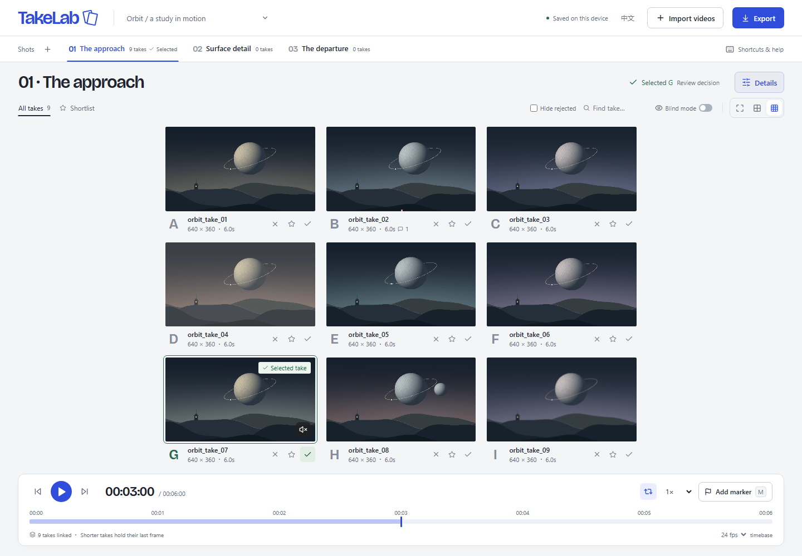

# TakeLab · AI 视频选片台

**同一个镜头生成了 30 次，快速选出最好的一条，并记住它是怎么做出来的。**

[English](README.md) · [使用指南](docs/USER_GUIDE.md) · [开发架构](docs/ARCHITECTURE.md)



TakeLab 处理生成之后的日常选片工作。把不同来源的视频放在一起，同步比较、标记穿帮、选出成片，再保留提示词与制作记录。无需账号、API Key 或模型费用，媒体文件不上传。

顶部切换镜头；**详情** 按需展开记录，**已选版本** 直接打开选片依据，**添加标记** 定位到当前素材时间。[设计记录](docs/UI_CONTACT_SHEET_2026-11-03.md) 保留参考依据；[画面放大对照](docs/UI_DENSITY_2026-11-03.md) 包含实测尺寸与截图。短窗口可滚动选片区，保持画面可看尺寸。

当前为 **v0.1.0 首版实现**：核心流程已在 Chromium 测试。它是评审工具，不提供剪辑软件的逐帧精确交付保证。

## 本地运行

安装 Node.js 22.12 或更新版本，建议先用桌面 Chrome / Edge。

```sh
git clone https://github.com/Ray0766/takelab.git
cd takelab
npm ci
npm run dev
```

打开 [http://127.0.0.1:4173](http://127.0.0.1:4173/)。第一次可直接点击“打开示例项目”；9 条原创程序生成短片已包含在仓库中，不需要自备素材。右上角可以切换中英文。

## 完整流程

1. **导入**：拖入多个视频，或点击“导入视频”。可选择按 `scene01_take_03.mp4` 一类文件名自动分组。
2. **比较**：切换 1 / 4 / 9 宫格，同步播放、变速、循环，按左右方向键逐步查看。更多素材分页加载。
3. **对齐**：在版本详情设置起始偏移，让不同视频从同一动作开始。较短的视频播完后停留在末帧。
4. **评选**：`S` 入围、`X` 淘汰、`W` 最终选定；一个镜头只保留一个最终版本。可以隐藏淘汰版本。
5. **盲选**：隐藏文件名、模型、提示词、参考图、种子与成本，并打乱顺序；选完后揭晓。画面内水印无法隐藏。
6. **标记**：按 `M` 在当前素材时间记录穿帮、亮点或备注。可点击标记回看；早于起始偏移的标记需先减小偏移。
7. **记录**：填写提示词、负面提示词、模型、种子、参数、美元成本，附上参考图。
8. **导出**：选择项目 ZIP、Markdown 制作记录，或带版本标签的无声对比视频。

**检查源帧** 会暂停九宫格，放大查看一条或两条原片：左右键按真实源帧移动，可联动放大；**对齐动作** 分别选取同一动作的两个时刻，并应用为起始偏移，可撤销。**保存源帧证据** 将完整 PNG、观察文字、真实时间戳及原片指纹一起保存；已选定成片时，自动关联到本镜头的选片依据。见[功能与验证记录](docs/SOURCE_FRAMES_2026-11-03.md)。

选定后进入 **选片依据**，填写理由，勾选本镜头任一版本的时间点证据，再打开对应制作记录。导出的稳定 ID 会串起“选片结果—观察时间点—生成记录”，恢复后保留关联。缺少理由或证据会明确提示。它能否让真实创作者选得更快、更准，仍是待验证假设；技术取舍和实测限制见 [DECISIONS](docs/DECISIONS.md) 与 [VALIDATION](docs/VALIDATION.md)。

## 导出与恢复

| 格式     | 用途与限制                                                                                                       |
| -------- | ---------------------------------------------------------------------------------------------------------------- |
| 项目 ZIP | 包含结构化记录、Markdown、参考图和证据 PNG；可选包含视频原片。未压缩内容最多 512 MB。重新导入后继续评选与编辑。  |
| 制作记录 | 可阅读、可分享的 Markdown，包含各镜头版本、选片结果、提示词、参数、成本与源视频时间码。                          |
| 对比视频 | 实时录制当前页，宽 1280 像素，最多 9 条、120 秒，无声。优先 WebM，浏览器支持时可回退 MP4。录制期间保持页面可见。 |

不含视频的 ZIP 在恢复后需要重新关联原文件。点击项目名旁的菜单打开备份；恢复会在确认后替换当前项目。盲选期间可导出匿名对比视频，导出完整记录前需揭晓来源。

原片缺失时，证据截图仍可独立查看。已保存源帧证据或动作锚点的素材会校验 SHA-256；同名、同大小但内容不同的文件会被拒绝。截图哈希也随包校验。这用于发现误关联和内容变化，不是不可篡改的签名。

## 使用边界

- 数据自动保存在当前浏览器、当前地址的 IndexedDB。换浏览器、域名或端口会看到不同工作区。清除站点数据、隐私模式和空间回收可能导致数据丢失，**请保留原视频并导出备份**。同一工作区请只用一个标签页编辑。
- 最多同页解码 9 条视频；导出期间会释放评审播放器。九路 4K 仍可能超出硬件能力，建议减少宫格，或在外部生成低分辨率代理。
- 建议使用 H.264 MP4 或 VP9 WebM；MOV / MKV 是否可播放取决于内部编码和浏览器。坏文件会单独报错，已成功导入的素材保留。
- 九宫格逐帧按钮仍按评审帧率计算步长，九路播放与实时视频导出不保证逐帧锁定。独立的**检查源帧**按实际 PTS 取帧并核对解码结果；不同帧率的两条视频取各自比较时刻之前的最近源帧，帧序号和时间戳不必相同。
- 源帧检查需要支持 WebCodecs / OffscreenCanvas 的桌面浏览器，以及可解码的 MP4 / WebM / Matroska SDR 素材。一次最多两条，每条最多 2 GiB、60,000 个视频包、4096 × 2160 像素（支持竖屏）。不支持的时间轴、HDR 或编码会明确提示；九宫格仍保留。打开时需读取完整文件计算指纹，大文件会有等待成本。每条视频最多 50 张证据、每个项目 500 张、每张最多 32 MiB。不用于色彩校样。
- 一次最多导入 200 条视频、一个项目最多 3,000 条。每个版本最多 30 张参考图，单图不超过 20 MB，支持 PNG/JPEG/WebP/GIF。
- 只保留一个活动项目。首版不接生成 API，不做自动评分、云协作、转码或无损剪辑。演示模型名称为虚构，不代表模型测评。

## 开发与发布

```sh
npm run check
npx playwright install chromium
npm run test:e2e
npm run test:frames           # 需要 FFmpeg，验证源帧和证据恢复
npm run build
npm run preview
```

静态产物为 `dist/`，可部署到 GitHub Pages 等静态网站托管服务，支持仓库子路径。请通过 HTTP 服务打开，不要直接双击 `dist/index.html`。仓库附带 CI 与**手动触发**的 Pages 部署工作流，推送代码不会自动发布网站。

发布前请阅读 [发布清单](docs/RELEASING.md)。贡献方式见 [CONTRIBUTING.md](CONTRIBUTING.md)。MIT 许可覆盖源码与原创演示素材；第三方依赖保留各自许可。你导入的素材所有权不变。
