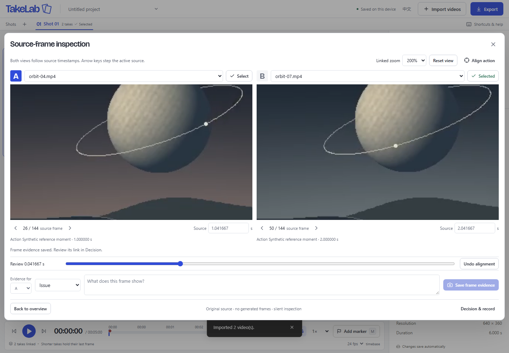

# Source-frame inspection, evidence and action alignment

Implemented and checked on **2026-11-03** after Ray authorized the first direction in the [technology research](TECHNOLOGY_RESEARCH_2026-11-03.md). This report documents local implementation and validation; it is not a deployment record.

## Delivered workflow

The native 1/4/9-take overview remains. **Inspect frames** pauses it and opens one or two original sources with actual source-frame navigation, a shared comparison time, linked zoom and manual action anchors. Enter a source time and press Enter or leave the field to seek. Both readers must settle before a screenshot can be saved. Arrows follow the active source's real frame sequence; mixed-FPS partners use their own preceding sample, not the same frame number.

**Align action** sets two named source moments as the existing start offsets. It does not change playback speed. Session undo restores previous offsets; manual offset editing clears an inconsistent anchor. A frame observation becomes a marker plus a complete display-oriented PNG, source PTS/track/index, original-file SHA-256 and PNG SHA-256. The image and marker commit atomically. A selected winner's decision automatically receives the evidence reference; markers created before selecting a winner can be linked later.

The export/restore demonstration uses original synthetic Orbit clips, not model evaluations: A is anchored at 1 s, B at 2 s; A's frame at **1.041667 s** supports the selection of B. The independent prompts for A and B survive restoration. Both full and records-only ZIPs contain the evidence PNG. Missing originals do not prevent viewing the image; a relink must match the stored fingerprint to resume adjacent-frame inspection.



[Full portable demo](evidence/source-frames-20261103/frames-full.takelab.zip) · [Records-only demo](evidence/source-frames-20261103/frames-records-only.takelab.zip) · [Exported production record](evidence/source-frames-20261103/project/record.md) · [Actual saved PNG](evidence/source-frames-20261103/original-frame.png)

## Choice, cost and references

Keep native playback as the mature baseline. Adopt pinned **Mediabunny 1.65.0** for demuxing and WebCodecs sample retrieval in dedicated workers, and **@noble/hashes 2.4.0** for incremental SHA-256. Reviewed [sample retrieval semantics](https://mediabunny.dev/guide/media-sinks), [reading media files](https://mediabunny.dev/guide/reading-media-files), the [pinned author source](https://github.com/Vanilagy/mediabunny/tree/v1.65.0) and [noble-hashes author documentation](https://github.com/paulmillr/noble-hashes). The earlier research contains current standards/release checks and alternatives; no new speculative model pipeline was introduced.

The practical gain is explicit source-frame identity and portable evidence. The earlier native-versus-worker probe retrieved 40/40 correct frames on **both** paths, so it does not establish a decoding accuracy or speed advantage. The VFR fixture demonstrates the actual distinction: after 1 s its next source frame is 1.1 s; nominal 24 fps stepping would request 1.041667 s and may repeat a frame. Faster selection and better creative decisions remain hypotheses requiring creator task comparisons.

The final production worker chunk is about **258.13 kB** minified, loaded when inspection opens. Main JS is **383.41 kB / 127.39 kB gzip**; CSS 40.99 kB. Opening reads the entire file for hashing, without building a full-file ArrayBuffer. There are up to two inspection workers with bounded retained samples; native players remain paused and may retain GPU surfaces. This is not a total-memory or latency guarantee. No model fees, uploads or remote inference were added. Mediabunny retains MPL-2.0; notices and corresponding source links ship with the static build. TakeLab's own files remain MIT.

Two interface directions were considered: a permanent detailed comparison pane, or a temporary wide inspection surface. The second preserves the recently enlarged overview. Reference methods reuse the prior [visual research](UI_REDESIGN_2026-11-03.md) and [contact-sheet design](UI_CONTACT_SHEET_2026-11-03.md):

| Reference                                                                                 | Specific method                                       | TakeLab translation                                                                                          | Boundary                                                                                                   |
| ----------------------------------------------------------------------------------------- | ----------------------------------------------------- | ------------------------------------------------------------------------------------------------------------ | ---------------------------------------------------------------------------------------------------------- |
| [Frame.io comparison viewer](https://help.frame.io/en/articles/9952618-comparison-viewer) | Spatial A/B comparison tied to observations           | Equal panes, shared review position, source-specific evidence and a return to the decision                   | No cloud review, account or frame-lock claim; product function reference, not a new hands-on account trial |
| [DaVinci Resolve Edit](https://www.blackmagicdesign.com/products/davinciresolve/edit)     | Source identity and explicit source/proxy distinction | Original-file hash + track + PTS remain authoritative behind inspection/export                               | No grading, proxy generation, editing timeline or mastering scope                                          |
| Paper's previously inspected canvas                                                       | Quiet perimeter controls leave the work visible       | Compact controls around large pictures, existing cobalt/contact-sheet typography and system Chinese fallback | Does not copy its artwork or turn review into an infinite canvas                                           |

Desktop panes use a 12 px gutter and neutral dark picture surround. Controls are compact; the existing Bricolage/system hierarchy and status colors are retained. Narrow windows stack the panes and scroll the dialog. Loading/cancellation communicate decoder state; no decorative animation or new asset pack was added.

## Validation and receipts

Machine: Windows Ray-5090, Core Ultra 9 285K, approximately 63.3 GiB RAM, RTX 5090; Chromium **156.0.8078.4**, Node **24.18.0**, FFmpeg **8.1**. Hardware decoding is not independently established. Tests use isolated browser profiles and original synthetic fixtures.

- **41 unit tests passed**: schema/provenance bounds, source-time consistency, missing evidence rejection, decision reconciliation and multi-chunk hash equivalence/cancellation.
- The full development run passed all **13 pre-existing browser flows**, plus four new flows. Its rotated-fixture test exposed an invalid fixture: FFmpeg 8.1 did not create a display matrix via the old metadata option. The generator now sets and verifies the actual 90° matrix; the corrected test passed. The production run below includes it.
- **All five new browser flows passed on the actual `dist/` build** on a plain HTTP-200 server without Range support. They cover full and records-only ZIP recovery, original/PNG fingerprint corruption, same-name/same-size wrong relinking, retained PNG without originals, actual player offsets after anchor application, separate winner/evidence prompts, blind identity/anchor-label hiding, keyboard input, close/reopen cancellation, undo, endpoint hold, mixed 24/30 fps, 60 fps boundaries, VFR, VP9 and rotated pixels. The VFR saved PNG decodes to 640×360 and the independent original-frame pixel code **33** at 1.1 s. [Static-host receipt](evidence/source-frames-20261103/static-host.json).
- Repository subpath `/takelab/` loads both built worker URLs correctly and opens source inspection over the nine-player demo. [Production screenshot](evidence/source-frames-20261103/production-subpath.png).
- A final targeted **decision + interface regression passed (2 flows)** after fixing immediate generation-record binding. The prior implementation could briefly keep the previous take's editor active during navigation; the new test asserts that neither candidate's prompt is overwritten by the other.
- **Three strict mixed-FPS 1080p synchronization trials passed** the existing targets: presented-timestamp p95 **41.7–50.0 ms at 1×**, **50.0–66.7 ms at 2×**. Targets remain 80/84 ms respectively. [Summary](evidence/source-frames-20261103/sync-summary.json) and [all raw trials](evidence/source-frames-20261103/sync-trials.zip). This measures callback-reported timing on two streams, not physical scanout or nine 4K streams. The earlier 83.3 ms miss remains documented in the baseline; these passes do not establish universal frame lock.
- Reviewed desktop, short-window, single-source, rotated and 390 px Chinese screenshots, including the scrolled evidence form. The existing nine/four-up actual-picture minimum guards passed. [Retained overview](evidence/source-frames-20261103/overview-nine.png), [short window](evidence/source-frames-20261103/inspection-short-window.png), [Chinese controls](evidence/source-frames-20261103/inspection-mobile-form-zh.png).
- Opened the exported PNG and read the actual Markdown/JSON; ZIP bytes and hashes were checked through real export/reimport flows. The pre-existing comparison-video regression produced VP9 **1280×876, 143 decoded frames, 6.0208 s**, and FFmpeg decoded the complete file without errors. It remains a real-time review copy.

Implementation fixes found by these checks include sub-microsecond PTS rounding at 30 fps, explicit WebM format registration, focus restoration, metadata-label accessibility after reload, decimal source-time editing, and immediate source identity when switching to the winner's generation record.

Reproduce:

```sh
npm ci
npm run check
npx playwright install chromium
npm run test:e2e
npm run test:frames                     # requires FFmpeg/FFprobe; generates bounded fixtures
npm run build
node scripts/check-frame-production.mjs # requires those generated fixtures
npm run test:sync                       # three strict 1080p trials
npm run format:check
```

## Remaining boundaries

Inspection supports browser-decodable MP4/WebM/Matroska SDR sources, with a 2 GiB / 60,000-packet / 4096×2160-pixel limit per source (portrait supported). Nonzero starting timelines, duplicate PTS, HDR, unavailable codecs and exceeded bounds fail explicitly. The native overview remains available. Inputs are not silently normalized, retimed or transcoded. Larger/longer files, HEVC/AV1, unusual edit lists, HDR color handling, Safari/Firefox, ordinary-laptop performance and 4K memory pressure have not been qualified. Opening/seek timeouts are 60/15 s; large-file hashing may reach them.

Evidence is limited to 50 images per take, 500 per project, 32 MiB per PNG and the existing 512 MB total archive limit. Storage eviction/quota fault injection and cross-tab conflicts have not been exhaustively tested; originals and exported backups remain necessary. Hashes detect byte changes against the saved record; the editable JSON is not a signature or an immutable audit trail. Old app versions may discard additive schema-1 evidence fields/images. Standalone Markdown image links need the extracted archive alongside them.

Actions are manually matched, and the record preserves current editable generation metadata rather than immutable historical prompt revisions. This implementation does not prove that people select faster or choose better, does not color-calibrate screenshots, and does not guarantee frame-locked overview playback or exact comparison-video export. No proxy generation, automatic issue scoring, generation API or cloud service was added.
